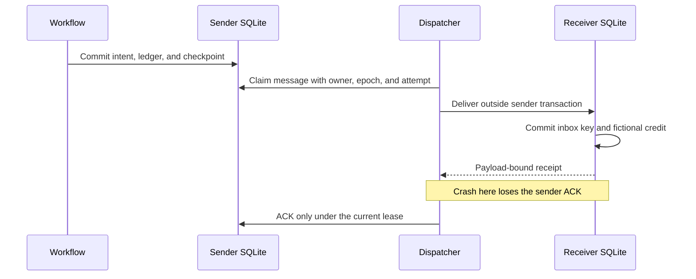

# Resilient agent runtime

The receiver commits a credit. The sender dies before recording the acknowledgement. On restart, should the command run again?

This implementation redelivers the same message. The receiver checks its retained inbox key and payload, then returns a duplicate receipt without adding another credit. Sender and receiver use separate SQLite databases; there is no transaction spanning them.

| Point in the replay | Sender | Receiver |
| --- | --- | --- |
| Workflow commits | Enqueue intent, ledger, checkpoint | No credit yet |
| Receiver commits, sender loses ACK | Inflight message | One inbox entry and seven fictional units |
| Dispatcher restarts | Second attempt, accepted ACK | Duplicate receipt; still seven units |
| Final allowed attempt loses ACK | Can end as a dead letter | Credit may already be committed |

The last row matters: a dead letter does not prove that no effect occurred.

## Follow that failure

```sh
python -m pip install -e .
python -m resilient_runtime outbox-demo --output artifacts/ack-gap.json
python -m resilient_runtime outbox-evaluate --output artifacts/delivery-cases.json
```

The [recorded replay](replays/outbox-demo.json) shows both durable stores before and after recovery. The protocol experiment passed **12/12 defined cases**, including eight concurrent deliveries, an admission race, payload conflict, outage/restart, and an actual child-process exit after receiver commit. This is an invariant count, not an availability percentage.



## Put a workflow on the outbox

```python
from resilient_runtime import Action
from resilient_runtime.outbox import OutboxRuntime, Receiver, Dispatcher

with OutboxRuntime("workflow.sqlite") as workflow:
    workflow.submit("request-1", [Action("credit-1", tool="enqueue_credit", amount=7)])
    workflow.run("request-1")

with Receiver("receiver.sqlite") as receiver, Dispatcher("workflow.sqlite", receiver) as dispatcher:
    dispatcher.drain()
    print(receiver.snapshot())
```

Workflow completion means the intent is durable, not that the receiver has applied it. Admission reserves future enqueue slots when a plan is submitted. The default backlog limit is 128 reserved or undelivered messages; delivery attempts are capped at five. Dead letters retain capacity until reconciliation. Message identity includes a persistent sender namespace, workflow, and action; a changed payload cannot reuse an inbox key.

A lease epoch fences sender queue updates. It cannot retract a receiver transaction. Cancellation stops uncommitted workflow actions, while already committed outbox intents remain deliverable. The `delivered` result flag means the sender accepted an ACK; `False` leaves the receiver outcome potentially uncertain.

## Local execution and checks

The base `Runtime` also supports fictional credits entirely within one database. Its effect, ledger, checkpoint, and event share a transaction; attempts are persisted separately. Final commit gates check cancellation, deadlines, and lease ownership. Invocation deadlines are cooperative and cannot kill a stuck Python hook.

```sh
python -m resilient_runtime evaluate --output artifacts/local-faults.json
python -m unittest discover -s verification -v
```

The recorded local evaluation passes **31/31 scenarios**. The complete suite contains **64 tests**, including separate connections, real concurrent deliveries, and abrupt process exits.

```text
src/resilient_runtime/runtime.py             local workflow state machine
src/resilient_runtime/outbox.py              admission, delivery, and receiver inbox
verification/                               crash, lease, and transaction checks
workflows/example.json                      fictional plan and local limits
replays/                                    executed local and two-store reports
operations/outbox-protocol.md                failure matrix and assumptions
dev/check_runtime.py                        package and CLI verification
```

[Commit boundaries](operations/commit-boundaries.md), [failure regressions](operations/failure-regressions.md), [fault scenarios](operations/fault-scenarios.md), and [ACK-gap results](operations/ack-gap-results.md) separate the local and two-store guarantees. The transport is an in-process adapter between real durable files. Inbox retention, stable message identity, continued scheduling, and receiver availability are assumptions. The code does not provide automatic reconciliation, authenticated transport, cross-database atomicity, or universal exactly-once delivery.
