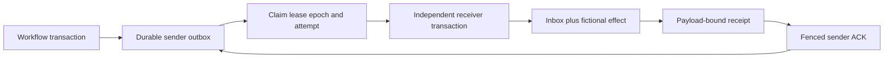
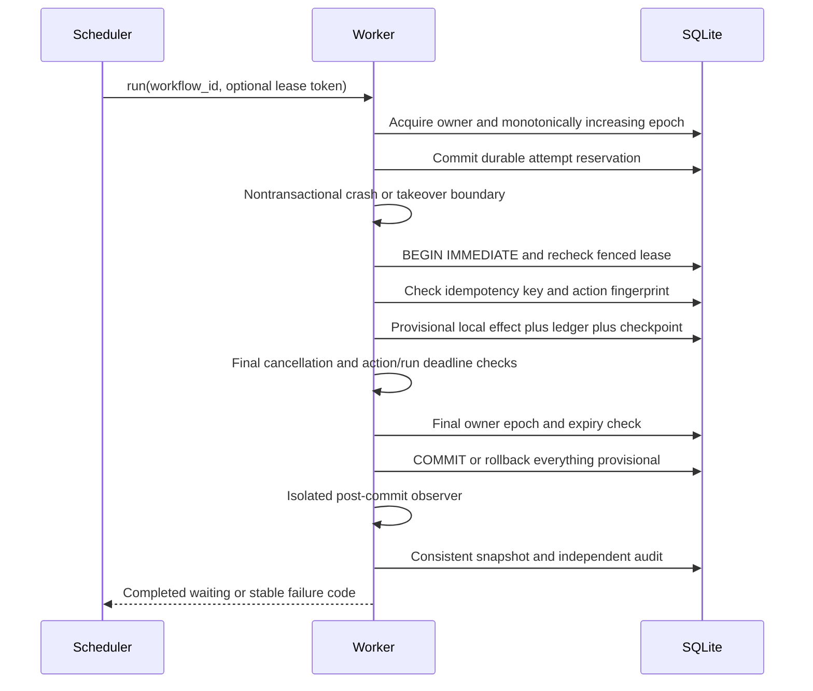

# Commit, lease, and receiver boundaries

The base `Runtime` executes a validated sequence of fictional local credits. `OutboxRuntime` adds an enqueue action whose intent commits in the workflow database, then a dispatcher delivers it to a separate receiver database. No model or plan text authorizes permissions. The local transaction sequence below remains the base runtime contract; the two-store extension is detailed in [outbox-protocol.md](outbox-protocol.md).

The sender has no open transaction over receiver execution. A crash after receiver COMMIT but before sender ACK causes redelivery; the receiver suppresses a matching duplicate using its retained inbox. Finite retry exhaustion can leave an uncertain dead letter despite a committed receiver effect. Admission reserves future enqueue slots at workflow submission. These are explicit protocol semantics, not a cross-database atomic or universal exactly-once claim. See [ACK-gap results](ack-gap-results.md).

## Persistence and transaction boundaries

- `workflows` stores plan fingerprint, state, checkpoint, retry time, submitted attempt ceiling, lease owner/expiry/epoch, and stable error code.
- `steps` stores the validated action, durable attempt count, and step state.
- `accounts` contains fictional local effects.
- `ledger` binds a stable `workflow_id:action_id` key to its action fingerprint and result.
- `events` records ordered metadata, fenced epochs, attempts, hashes, checkpoints, and error codes. An index supports workflow event lookups.

Submission persists the original retry ceiling. A restarted worker may impose a stricter ceiling but cannot widen the original. The attempt reservation commits separately before effects, so repeated crashes consume attempts even when their provisional effects roll back.

The effect transaction holds SQLite's writer lock, verifies owner/epoch/expiry and terminal state, then applies a new effect or suppresses an existing matching ledger key. Effect, ledger, checkpoint, and commit event share that transaction. Immediately before commit, callback cancellation, action/run deadlines, and lease fencing are checked again. Late failures roll back all provisional changes. Commit exceptions explicitly roll back the connection. A repeated key with another fingerprint is a terminal conflict.

The `after_attempt_reserved` fault boundary runs without an open transaction. Tests can kill a process or arrange takeover there; the resumed old worker must pass fencing again. The `after_commit` observer is isolated from transactional retry logic: its failure cannot downgrade a completed step or retry a published effect. It reports `post_commit_hook_error` and stops, leaving the next checkpoint resumable.

| Failure boundary | Durable result | Recovery |
| --- | --- | --- |
| Before attempt commit | No attempt or effect | Retry normally |
| After reservation, before effect commit | Attempt retained; effect/ledger/cursor rolled back | Retry after lease expiry, within persisted ceiling |
| After effect commit, before response | Effect/ledger/cursor retained | Resume next checkpoint |
| Late action timeout | Provisional transaction rolled back | Bounded retry with persisted backoff |
| Late invocation deadline | Provisional transaction rolled back | Pending workflow; new invocation may resume |
| Expired or replaced lease | No new committed effect | Current owner or new acquisition continues |
| Callback cancellation before commit | Provisional transaction rolled back | Terminal cancellation; earlier commits retained |
| Post-commit observer failure | Published step remains completed | Stop with diagnostic; resume next checkpoint |
| Invalid/throwing backoff policy | No effect; ownership cleared | Stable terminal policy failure |

A deliberate stale-cursor test checks ledger replay suppression. Normal crash recovery never creates that inconsistency because ledger and cursor are atomic.

## Lease and time contract

`acquire` returns a `Lease` token or `None` for a busy, waiting, or terminal workflow. Every acquisition increments a persisted epoch. `heartbeat` extends only a matching unexpired owner/epoch and cannot resurrect an expired token. `release` uses both owner and epoch and cannot clear replacement ownership. `run(..., lease=token)` executes under a previously acquired token. Tokens coordinate trusted local workers; they are not user authentication.

Persisted retry/lease timestamps use a wall clock. Invocation/action budgets use a monotonic timer. Default values are three attempts, 32 actions, one second per action, five seconds per invocation, a ten-second lease, and bounded exponential backoff starting at 0.1 seconds. All numeric policies reject booleans, nonfinite values, and invalid types. Permission sets are copied into immutable state.

Hooks are trusted synchronous code. Deadline checks cannot kill a hung hook, nor guarantee a commit syscall finishes before a deadline that expires during that syscall. SQLite lock acquisition has a separate two-second timeout. A database cancellation waits behind an active writer and cannot revoke an effect committed first; callback cancellation is checked before publication. Wall-clock drift and mixed-version workers are unsupported.

Missing columns in a legacy file receive an epoch of zero and the previous default ceiling of three. An older custom ceiling was never persisted and cannot be reconstructed automatically; migrate such workflows explicitly. This additive compatibility path is not a managed migration system.

## Consistent evidence and independent audit

Snapshot queries run in one WAL read transaction. A concurrent writer cannot combine an old cursor with a newly committed ledger/balance in one export. The newest 1,000 events are exported in chronological order with `event_count` and `trace_truncated`; older database history remains retained.

`audit(workflow_id)` independently checks step positions, checkpoint range, completed-step agreement, durable attempt ceilings, ledger cardinality/positions, idempotency keys, action fingerprints, and credited-result binding. It reports violations rather than trusting a success status. It does not prove global account conservation, external outcomes, source authenticity, availability, or corruption repair.

## Verification and boundaries

The expanded evaluation covers 31 scenarios: the original 19 plus late commit gates, observer/backoff failures, fencing, durable retry policy, consistent snapshots, four real worker threads, and actual child-process termination before/after commit. Process exits use `os._exit(23)` and a new connection; restart expiry uses a controlled wall-clock offset without sleeping. This demonstrates process-death recovery, not hardware power-loss durability or throughput.

All SQL values are parameterized and identifiers are bounded. The only effect is an application-authored SQLite balance update. External HTTP APIs cannot join this transaction: provider idempotency, reconciliation, or an outbox/inbox protocol is required. This project makes no production exactly-once claim. Tenancy, authentication, retention, backups, deployment, clock monitoring, and production financial operations remain outside the lab. No model calls or provider costs occur.

See [failure-regressions.md](failure-regressions.md) for reproduced failures and regression evidence.
