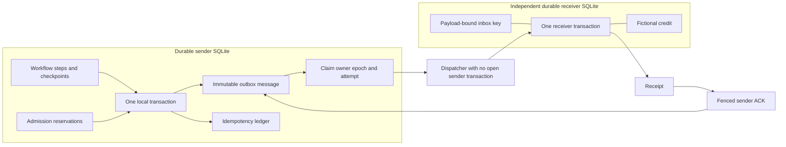

# Design: transactional outbox/inbox across two durable stores

## The invariant and the unavoidable gap

The sender must never publish a workflow checkpoint saying an enqueue action committed without retaining its message intent. The receiver must never commit an inbox key without the corresponding fictional credit, or repeat a credit for the same retained key and payload. These are **two local invariants**, implemented by **two separate SQLite transactions**. There is no cross-database transaction, `ATTACH`, two-phase commit, or exactly-once transport.

The unavoidable gap is between receiver COMMIT and sender ACK. A lost process or response leaves the receiver effect committed while the sender still sees an inflight message. Recovery redelivers the same identity and body; the receiver's inbox detects the duplicate atomically with its effect. A final-attempt ACK loss can exhaust the sender's budget despite an applied effect. The implementation preserves that uncertain state as a dead letter instead of assuming failure or pretending a distributed atomic commit occurred.

## Data model and identity

`OutboxRuntime` extends the existing workflow effect boundary rather than implementing a separate fake workflow. `enqueue_credit` inserts an outbox row inside the same transaction that writes the existing ledger, advances the checkpoint, and appends the commit event. A pre-commit crash rolls all of them back; the durable attempt reservation remains separate.

Each sender database owns a persistent random namespace. Message ID is `sender_id:workflow_id:action_id`. Canonical JSON includes protocol version, sender namespace, workflow/action IDs, account, and bounded integer amount; SHA-256 binds the whole body. Two independent senders can use the same workflow/action IDs without colliding at a receiver. Restoring/resetting namespaces deliberately changes deduplication identity and is an operator responsibility.

The sender outbox stores immutable payload/hash, workflow/position binding, state, attempt count, submitted retry ceiling, next due timestamp, owner, monotonically increasing lease epoch, expiry, and ACK timestamp. The receiver stores inbox identity/hash/body/result and the fictional account balance. Its primary-key uniqueness and `BEGIN IMMEDIATE` serialize duplicate deliveries.

## Sender admission and local execution

Submission reserves all future enqueue slots atomically. Admission checks:

`undelivered_outbox_rows + active_uncommitted_reservations + requested_enqueues <= capacity`

Reservations and workflow/step rows commit together. A successful enqueue converts one reservation into one outbox row inside the effect transaction, preserving occupancy. Failed/cancelled workflows stop counting unused reservations; previously enqueued messages continue to occupy capacity and can still be delivered. Dead letters occupy capacity, making unreconciled failures visible rather than silently allowing an unbounded backlog. Delivered rows and old reservations remain retained metadata; bounded admission is not a disk-retention policy.

Capacity (1–1,024) and delivery retry ceiling (1–10) are persisted. Reopening with different policies fails instead of widening an existing queue. Idempotently resubmitting the same workflow does not consume another reservation. Admission races serialize under the sender writer lock.

## Claim, delivery, and ACK algorithm

1. **Claim transaction:** select a due pending message or expired inflight lease. Persist a new owner/epoch, attempt increment, and expiry. Exhausted/corrupt messages become dead letters. The poison/exhaustion scan is bounded by admission capacity.
2. **Release sender transaction:** validate current ownership at the send gate. No sender lock is held over receiver I/O.
3. **Receiver transaction:** look up the inbox key. A matching body/hash returns a duplicate receipt. A conflicting payload is rejected. A new message inserts inbox/result and applies the account credit atomically.
4. **ACK transaction:** validate receipt identity/hash/amount and require the sender's current owner, epoch, unexpired lease, and unchanged payload. Only then mark delivered. A stale sender can still deliver a duplicate after the send gate races with expiry, but cannot acknowledge a replacement's message.
5. **Failure/retry:** persist a bounded exponential retry due time; never sleep internally. After the durable ceiling, retain a dead letter. Caller scheduling and eventual receiver availability are required for progress.

`drain` executes at most a configured batch (default 64, cap 1,024). Each attempt has a cooperative call deadline; a receiver can commit before a late response is classified as a timeout. Retrying that uncertain response is safe under retained inbox identity. The deadline cannot kill a hung Python call. SQLite lock waits have their own two-second bound.

## Failure matrix

| Failure point | Sender durable state | Receiver durable state | Recovery |
| --- | --- | --- | --- |
| Workflow effect transaction before commit | Reservation and attempt remain; no outbox/ledger/checkpoint advance | None | Retry workflow within its persisted ceiling |
| After workflow commit, before dispatch | Pending outbox and advanced checkpoint | None | Dispatcher claims intent |
| After delivery claim, before receiver commit | Inflight owner/attempt retained | No effect/inbox | Reclaim after expiry and retry |
| Receiver failure before its commit | Inflight or retry scheduled | Both inbox and effect roll back | Retry the same payload |
| Receiver commits, sender process dies before ACK | Sender still inflight | Inbox and effect retained | Redeliver after expiry; receiver returns duplicate |
| Two deliveries overlap | At most current epoch can ACK | One first application; duplicates suppressed | Replacement ACK is accepted; stale ACK rejected |
| Same message ID with a new payload | Conflict/dead letter | Original inbox/effect unchanged | Investigate identity misuse; do not overwrite |
| Cooperative timeout after receiver commit | Pending retry, possibly later dead letter | Effect may already exist | Duplicate-safe retry; do not equate error with no effect |
| Last allowed attempt loses ACK | Dead letter after expiry | Effect may already exist | Explicit operator reconciliation; no automatic certainty |
| Sender ACK commits, observer then fails | Delivered remains delivered | Committed | No retry/downgrade of delivered state |

## Complexity and practical tradeoffs

Let `N` be retained sender messages, `I` receiver inbox size, `A` accounts, `C` admission capacity, and `B` dispatch batch size. Receiver primary-key lookup and account update are B-tree operations, approximately `O(log I + log A)` per message, with durability I/O dominating small examples. Sender claim uses a status/due/expiry index and selects one message; a claim can skip at most `C` exhausted/corrupt entries. Query plans and retained history matter: count-based admission and ordering have linear/worse-case scan costs, so no unconditional sublinear sender claim/admission claim is made. Exported queue snapshots cap their rows at 1,000; a dispatch batch stores `O(B)` outcomes.

SQLite serializes each database's writers, so this is a correctness slice, not a high-throughput broker. There is no partitioning, FIFO guarantee across workers, retry jitter, automatic dead-letter reconciliation, compaction, or network transport. Fictional credits commute; noncommutative actions would need additional ordering/version semantics. A real HTTP adapter must authenticate peers, preserve idempotency identity, validate receipts, and bound transport calls without holding the sender transaction.

## Assumptions and exact scope

- Receiver inbox identity must be retained as long as a message can be redelivered, and inbox/effect storage must remain consistent. Deleting inbox rows or restoring incompatible backups can permit duplicates.
- Sender namespace and message ID/payload remain stable across retries. Namespace loss/recreation changes identity.
- Filesystem/SQLite durability guarantees are assumed. Tests cover process death, not power loss, disk corruption, or independent disaster recovery.
- Fencing protects sender queue state. It cannot retract a receiver effect already committed, and cancellation of a workflow cannot erase its committed outbox intents.
- Finite retry budgets and unavailable receivers prevent unconditional eventual-delivery guarantees. Dead letters require reconciliation.
- Transport is in-process between two real durable stores; no remote network, broker, production payment, or universal distributed exactly-once claim is made.

See [ack-gap-results.md](ack-gap-results.md) for executed results and commands.
